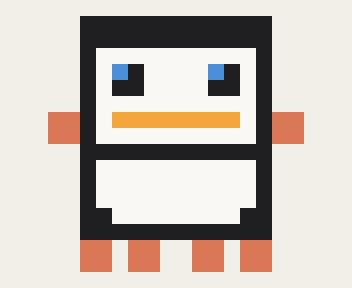

<p align="center">
  
</p>

<h1 align="center">kowalski</h1>

<p align="center">
  <b>One command that tells you what the current session is actually doing.</b><br>
  A status briefing for Claude Code, recalled from memory, costing nothing until you ask.
</p>

<p align="center">
  
  
  
</p>

---

You are twelve tangents deep, the context compacted once, and somewhere in there you agreed to
something you cannot remember. Type `/kowalski` and get this:

> ### Kowalski, analysis
>
> **Mission:** Get the nightly build green again and stop the disk from filling up.
>
> **Done**
> - The build server's disk was grown from 80 to 120 GB; 91 GB is free.
> - The worker container's memory limit went from 256m to 1g, and it stopped crash-looping.
> - The `cache-cleanup` script is fixed, and its tests pass.
>
> **In flight:** *nothing*
>
> **Next:** Open a PR for the `target/` cleanup in the CI config.
>
> **Needs you**
> - Rotate the deploy token; only you have access to it.
> - Should idle worktrees be cleaned automatically, or only on request?
>
> **Snags**
> - This session was compacted, so the first hour isn't visible.
> - The fix for the flaky `sync` test is assumed, not proven; it passed once.
>
> **On disk**
> - `fix/cache-cleanup`: 2 commits not pushed.
>
> `<(O_O)>` *We have a situation.*

It's plain Markdown, so it renders natively in the terminal and wraps cleanly in narrow clients
such as mobile apps, where a fixed-width box would break.

## Install

```sh
git clone https://github.com/Aethryl/kowalski-analysis ~/.claude/skills/kowalski
```

Then `/reload-skills`, or start a new session. The command comes from the frontmatter, not the
directory, so the folder can be called anything. Needs Claude Code new enough for
`disable-model-invocation` in skill frontmatter; tested on v2.1.310.

## What it costs

Nothing until you type it. Most skills pay a standing tax: their description sits in every
request so the model can choose them. This one sets `disable-model-invocation: true`, which
keeps the description and the body out of the preload entirely. You are the trigger, so it
never needs to be chosen. Measured rather than estimated — with the flag on, the skill is
absent from a live session's skill listing; take the flag off and it appears.

The briefing itself is recalled from the session already in context. It never re-reads the
transcript or re-runs tools. The only thing it touches on disk is `git status`, and only when
the session actually wrote something.

## What it will not do

- **Claude cannot invoke it.** `disable-model-invocation` is what makes it free; the price is
  that asking for a status report in words won't produce one. `/kowalski` is the only way in.
- **It only knows this session.** By design, because it's there to catch you up on the session
  you are sitting in.
- **It reports, it does not act.** No commits, no cleanup, no writes of any kind.

## License

MIT
